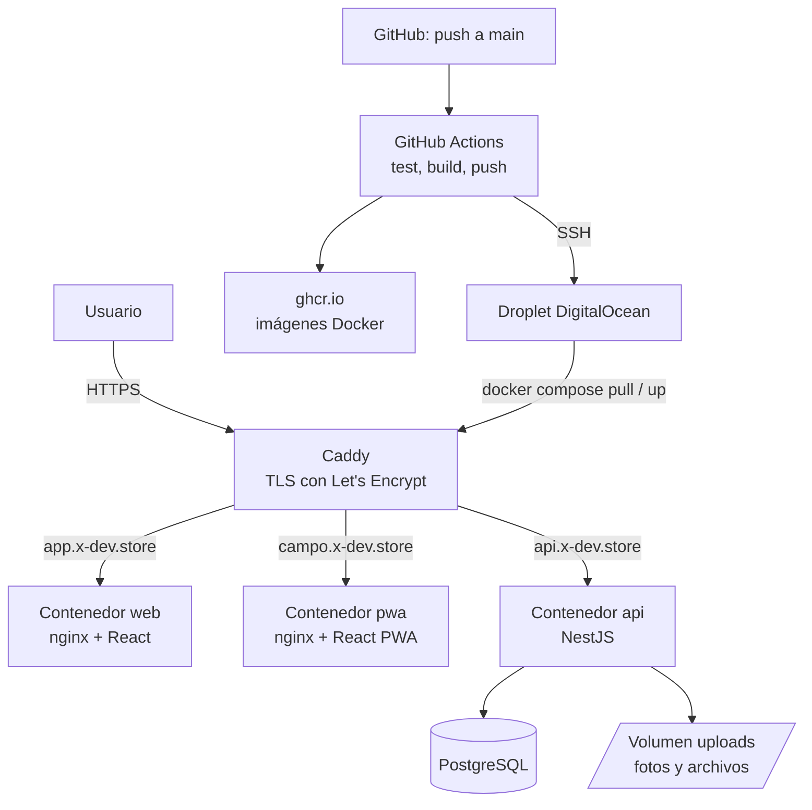
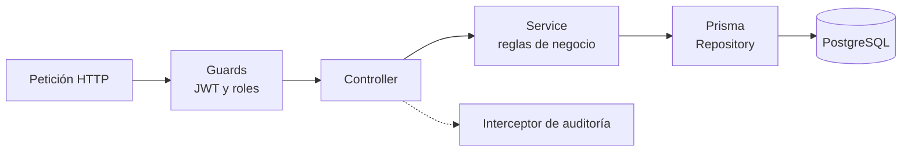

# Arquitectura del Sistema

La plataforma es un **monolito modular en capas**, desplegado en contenedores Docker sobre un Droplet de DigitalOcean. Hay una API única y dos aplicaciones de interfaz: una web para administración y una PWA para el personal de campo.

## Diagrama de despliegue

## Capas del backend

Flujo: **Controller → Service → Repository (Prisma)**. Los controladores reciben y validan la petición (DTOs), los servicios contienen la lógica de negocio y Prisma accede a la base de datos.

## Componentes

| Componente | Descripción |
|---|---|
| Backend (API REST) | NestJS con TypeScript. Endpoints bajo `/api/v1` y Swagger en `/api/docs`. |
| Web de administración | React + Vite, para escritorio: catálogos, lotes, calidad, traslados, procesos, liquidaciones, auditoría. |
| PWA de campo | React + Vite + Dexie (IndexedDB), instalable, con cola de envío para zonas sin señal. |
| Base de datos | PostgreSQL con Prisma (esquema tipado y migraciones versionadas). |
| Archivos | Las fotos se guardan **en el disco del servidor**, en la carpeta `uploads` montada como volumen Docker (`uploads:/app/uploads`) para que sobrevivan a los redespliegues. En la base solo se guarda la clave relativa y los metadatos. |
| Proxy inverso | Caddy: enruta `app.`, `campo.` y `api.` y renueva los certificados HTTPS automáticamente. |

Contenedores en producción: `db`, `api`, `web`, `pwa` y `caddy`.

## Justificación de las decisiones técnicas

| Tema | Decisión | Justificación |
|---|---|---|
| Arquitectura | Monolito modular en capas | Un solo despliegue y transacciones simples: inventario y trazabilidad requieren consistencia. Microservicios añadirían complejidad sin beneficio para este tamaño. |
| Backend | NestJS | Estructura modular, guards para roles, validación con DTOs, interceptores para auditoría y Swagger integrado. |
| ORM | Prisma | Esquema tipado y migraciones versionadas. |
| Base de datos | PostgreSQL | Relacional, integridad referencial, restricciones `CHECK`, JSONB para auditoría y consultas recursivas para la trazabilidad. |
| Frontend | React + Vite, dos apps (`web` y `pwa`) | Cada app se optimiza para su usuario (escritorio o móvil) con la misma API y la misma base de datos. |
| PWA | Service worker + IndexedDB | Instalable y con cola offline para zonas rurales con poca señal. |
| API | REST (`/api/v1`) con Swagger | Simple, estándar y fácil de consumir desde ambos frontends. |
| Autenticación | Propia (bcrypt + JWT + refresh token) | Control total y demuestra hash, sesión, expiración y recuperación de contraseña. Se descartó Auth0 porque oculta esos mecanismos. |
| Archivos | Disco local con volumen Docker | Suficiente para la carga del proyecto y sin dependencias externas. Migrar a almacenamiento de objetos (S3/Spaces) queda como mejora futura. |
| Contenedores | Docker + Docker Compose | Mismo entorno en desarrollo y producción. |
| Registry | GitHub Container Registry | Integrado al repositorio. |
| CI/CD | GitHub Actions | Pruebas, build, push y despliegue automáticos en cada cambio a `main`. |
| Nube | DigitalOcean (Droplet) | Económico y suficiente; permite Docker Compose sin Kubernetes. |
| HTTPS | Caddy + Let's Encrypt | Certificados válidos con renovación automática. |
