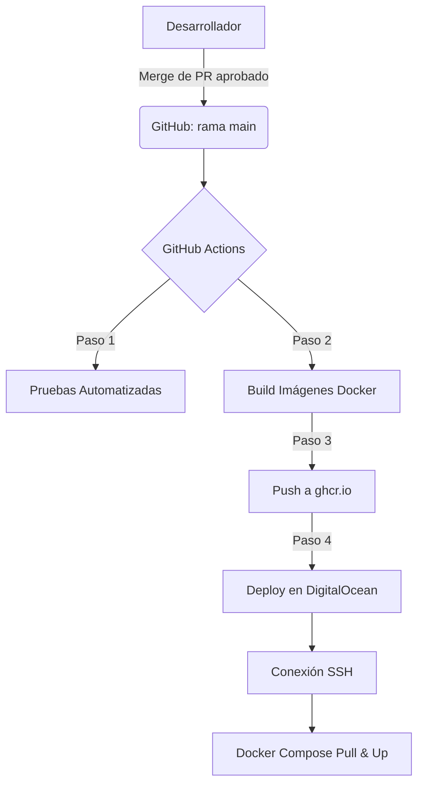

# Integración y Despliegue Continuo (CI/CD)

El proyecto utiliza GitHub Actions para automatizar el ciclo de vida del software, garantizando que cada cambio validado en la rama `main` se construya, publique y despliegue automáticamente en el entorno de producción en DigitalOcean.

## Flujo del Pipeline

## Cómo llega un cambio a producción

La rama `main` está protegida: no se hace *push* directo. El recorrido de un cambio es:

1. Se crea una rama nueva (por ejemplo `feat/tema` o `docs/tema`) y se hace *push* de esa rama.
2. Se abre un **Pull Request** hacia `main`.
3. Otro integrante del equipo lo revisa y lo **aprueba**.
4. Se hace **merge** a `main`. Ese merge dispara el pipeline: pruebas → build → push a `ghcr.io` → despliegue por SSH.
5. En el Droplet, `docker compose pull` y `docker compose up -d` actualizan los contenedores y el cambio queda visible en producción.

## Detalle de Fases
Pruebas Automatizadas: Al integrar código, el pipeline instala las dependencias (npm ci) y ejecuta las pruebas unitarias (Jest) del backend. Si las pruebas fallan, el proceso se detiene para proteger el entorno de producción.

Construcción (Build): Se compilan las aplicaciones principales (API NestJS, Web React, PWA React) y se empaquetan en contenedores Docker independientes.

Registro (Push): Las imágenes generadas se etiquetan y se suben al GitHub Container Registry (ghcr.io) integrado en el repositorio.

Despliegue (Deploy): A través de SSH, GitHub Actions se conecta al Droplet de DigitalOcean, accede al directorio del proyecto (/opt/trazabilidad), descarga las nuevas versiones de las imágenes (docker compose pull) y reinicia los servicios (docker compose up -d).

## Secretos Configurados en GitHub
Para que el flujo automatizado acceda al servidor de forma segura, se configuraron los siguientes secretos en el repositorio:

SSH_HOST: Dirección IP pública del Droplet.

SSH_USER: Usuario del servidor con permisos de ejecución.

SSH_PRIVATE_KEY: Llave privada autorizada en el servidor para permitir el acceso sin contraseña.

## Gestión de Tráfico y HTTPS
Una vez que los contenedores están en ejecución, Caddy actúa como proxy inverso. Este servicio intercepta el tráfico entrante, aprovisiona y renueva automáticamente los certificados TLS (HTTPS) mediante Let's Encrypt, y enruta las peticiones web, móviles y de la API a sus respectivos contenedores.
