# Manual de Usuario – PWA de Campo

La PWA (aplicación web progresiva) es la herramienta del personal de campo y de bodega para registrar recepciones de cardamomo, tomar fotos, escanear códigos QR y registrar inspecciones, incluso en zonas rurales con poca o ninguna señal. Está disponible en **https://campo.x-dev.store**.

## 1. Instalación

La PWA se instala como una aplicación más, sin pasar por una tienda de aplicaciones.

| Dispositivo | Pasos |
|---|---|
| **Android (Chrome)** | Abrir https://campo.x-dev.store, tocar el menú ⋮ y elegir **Instalar aplicación** (o **Agregar a pantalla de inicio**). |
| **iPhone / iPad (Safari)** | Abrir https://campo.x-dev.store en Safari, tocar **Compartir** y elegir **Agregar a pantalla de inicio**. |
| **Computadora (Chrome)** | Abrir la dirección y hacer clic en el ícono de instalación de la barra de direcciones. |

Al terminar aparece el ícono **Trazabilidad** en la pantalla de inicio.

> La primera vez que se abre la aplicación **se necesita internet**, porque descarga los catálogos (centros, productores y fincas). Después, esos datos quedan guardados en el teléfono.

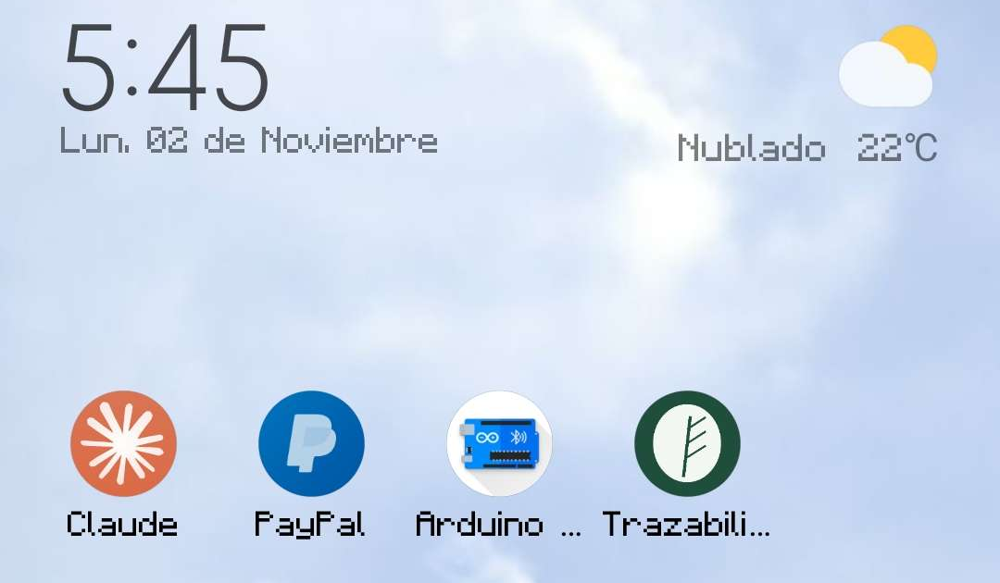

## 2. Inicio de sesión

1. Abrir la aplicación y escribir el correo y la contraseña.
2. Si se olvidó la contraseña, tocar **¿Olvidaste tu contraseña?**.
3. Tras 5 contraseñas incorrectas la cuenta se bloquea temporalmente; un administrador puede desbloquearla.

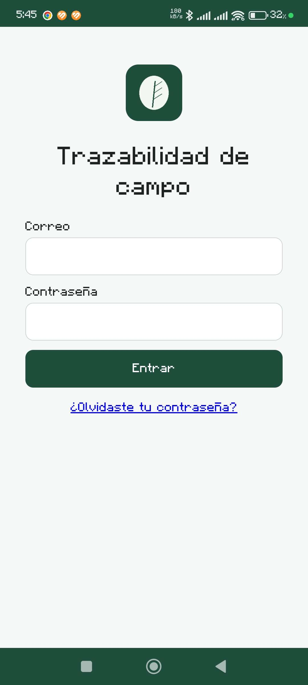

## 3. Menú principal

En la parte superior se muestra el estado de la conexión: **En línea** o **Sin conexión**. El menú tiene cinco opciones:

| Opción | Para qué sirve | Quién la ve |
|---|---|---|
| **Nueva recepción** | Registrar una entrega de producto | Administrador, Supervisor, Báscula y Campo |
| **Escanear QR** | Abrir un lote o una recepción desde su código | Todos |
| **Tareas pendientes** | Ver las tareas asignadas (por ejemplo, inspecciones) | Todos |
| **Productores y entregas** | Consultar un productor, sus fincas y sus entregas | Todos |
| **Mis envíos y comprobantes** | Ver lo pendiente de enviar y los comprobantes con su QR | Todos |

Si el botón **Nueva recepción** aparece deshabilitado con el mensaje "Descargando catálogos…", falta conexión para la primera descarga de catálogos; si persiste, avisar al administrador.

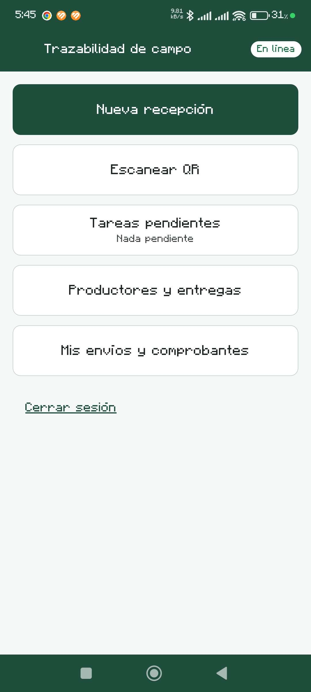

## 4. Registrar una recepción

1. Tocar **Nueva recepción**.
2. Elegir el **centro de acopio**.
3. Buscar y elegir el **productor** (por código o nombre) y su **finca**.
4. Elegir el **estado del producto**: uva (fresco), pergamino (seco) u oro (limpio).
5. Escribir el **peso bruto** y la **tara** en kilogramos. El **peso neto** se calcula solo.
6. Opcionalmente, anotar la **humedad (%)** y las **observaciones**.
7. Opcionalmente, **tomar una foto** con la cámara; se comprime antes de enviarse y se puede **quitar** si no sirve.
8. Guardar.

El peso bruto debe ser mayor que cero y el peso neto (bruto menos tara) también. Cada recepción se guarda con un identificador único generado en el teléfono, de modo que, aunque se reintente el envío, **no se duplica**.

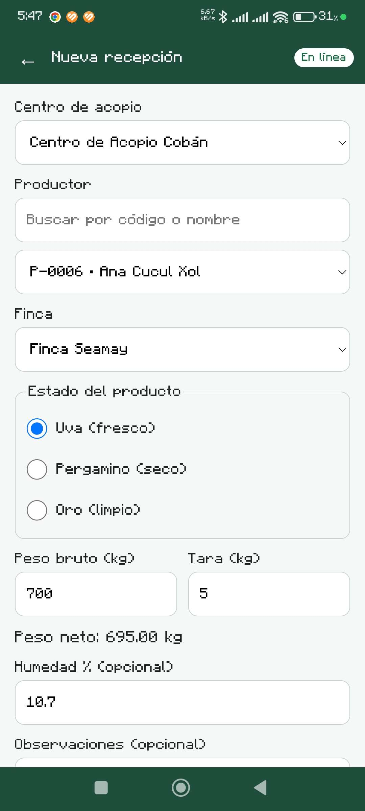
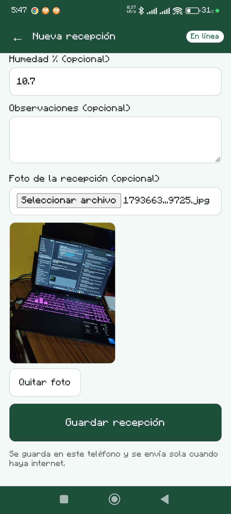

## 5. Comprobante con código QR

Al guardar se genera un **comprobante** con un código QR. El QR contiene solo una dirección con un valor aleatorio, sin datos del productor ni del peso. Los comprobantes quedan en **Mis envíos y comprobantes**, desde donde se pueden volver a ver.

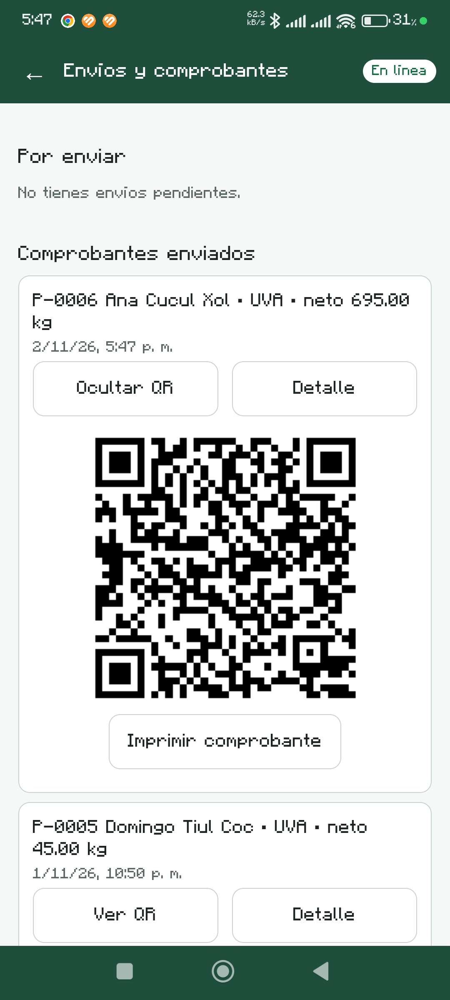

## 6. Trabajo sin conexión

Si no hay señal, la aplicación sigue funcionando:

1. El indicador cambia a **Sin conexión**.
2. La recepción (y su foto) se guarda en el teléfono y aparece en **Mis envíos y comprobantes → Por enviar**, con el mensaje "Se guarda en este teléfono y se envía sola cuando haya internet".
3. Cuando vuelve la conexión, la cola se **envía sola**. También se puede forzar con **Enviar pendientes ahora**.
4. Si un envío falla, aparece **Con error** y el botón **Reintentar**.

La inspección de calidad también funciona sin conexión y se envía sola al volver la red.

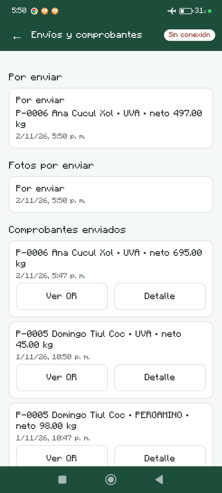
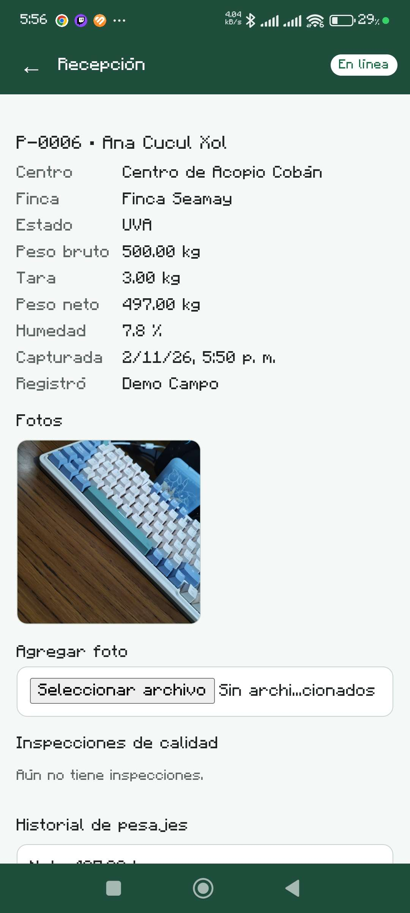

## 7. Detalle de una recepción y nuevo pesaje

Al abrir una recepción enviada se ven sus datos, **fotos**, inspecciones y el **Historial de pesajes**.

- **Volver a pesar** (Administrador, Supervisor y Báscula): se escribe el nuevo **Peso bruto (kg)**, la **Tara (kg)** y el **Motivo**. El pesaje anterior **no se borra**: queda en el historial.
- **Reimprimir comprobante (QR nuevo)**: genera un QR nuevo y el anterior deja de funcionar.

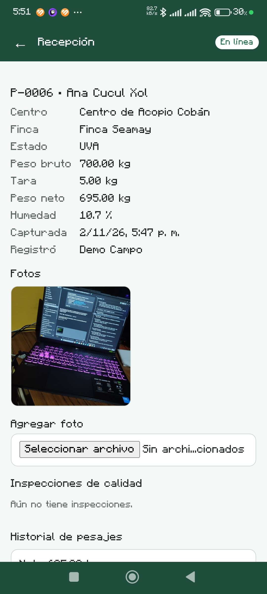

## 8. Productores y entregas

Muestra un productor con su organización, ubicación, fincas y sus últimas entregas, incluidas las capturadas sin conexión una vez enviadas.

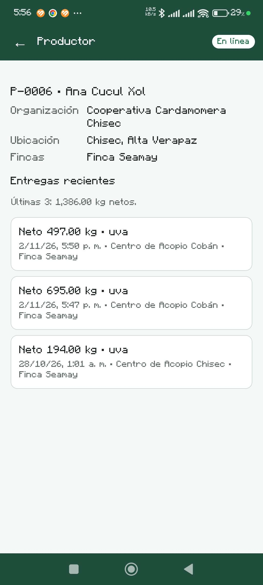

## 9. Escanear un código QR

1. Tocar **Escanear QR** y permitir el uso de la cámara.
2. Apuntar al QR de un lote o de un comprobante. Si la cámara no está disponible, se puede escribir el código y tocar **Buscar**.
3. La PWA abre el detalle: para un lote, su estado, existencia, ubicación y recepciones de origen.

También se puede abrir la aplicación directamente desde el QR con la cámara del teléfono.

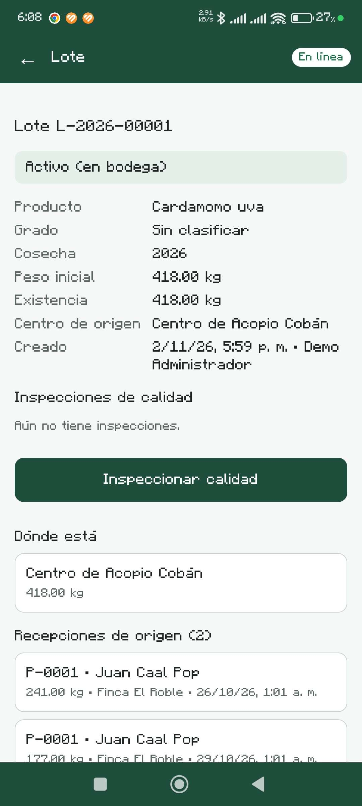

## 10. Tareas e inspección de calidad (rol Calidad)

Cada recepción nueva genera automáticamente una **tarea de inspección** para el rol Calidad.

1. Abrir **Tareas pendientes** y elegir la tarea.
2. Registrar la **inspección de calidad**: resultado (aprobada o rechazada), grado, humedad, impurezas, defectos y observaciones. Si se elige un grado, pasa a ser el grado del lote.
3. Al guardar, la inspección queda en la recepción y **la tarea se cierra sola**.

Los roles que pueden registrar inspecciones son Administrador, Supervisor y Calidad. El rol Campo no las registra.

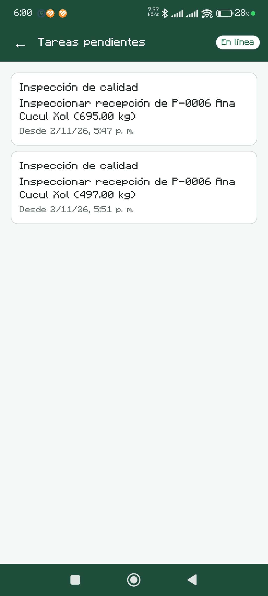
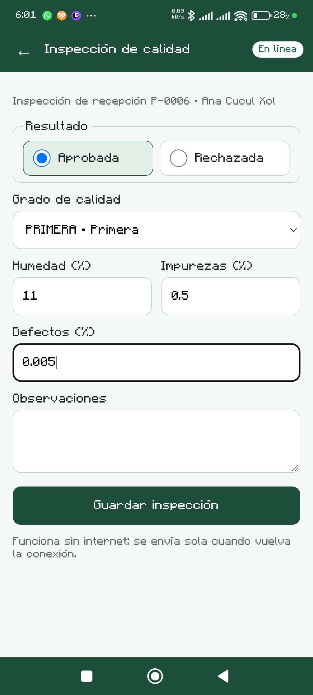
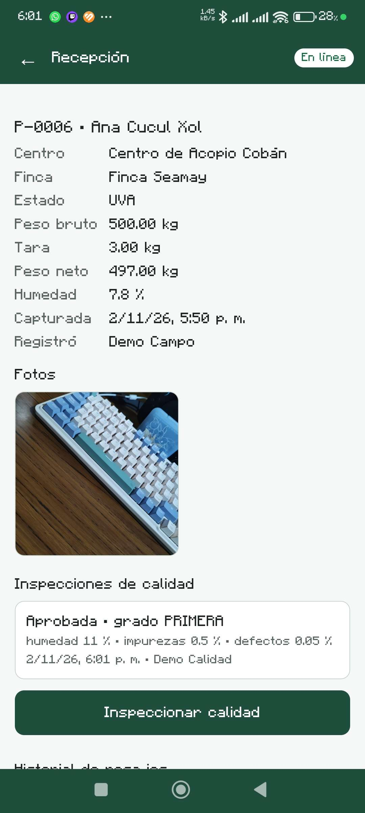
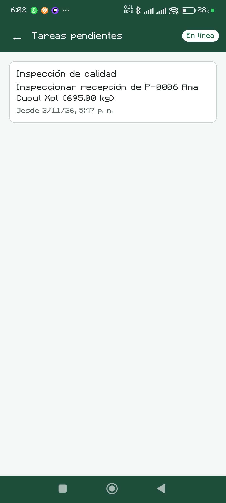

## 11. Preguntas frecuentes

| Situación | Qué hacer |
|---|---|
| **Nueva recepción** está deshabilitado | Conectarse a internet para descargar los catálogos; si sigue igual, avisar al administrador. |
| La recepción quedó en "Por enviar" | Es normal sin señal. Se enviará sola; también se puede usar **Enviar pendientes ahora**. |
| Un envío aparece "Con error" | Tocar **Reintentar**; si persiste, avisar al administrador. |
| No puedo entrar y la cuenta está bloqueada | Esperar el tiempo de bloqueo o pedir a un administrador que la desbloquee. |
| La cámara no abre al escanear | Revisar el permiso de cámara del navegador o escribir el código a mano. |
