# Manual de Usuario – Aplicación Web de Administración

Aplicación web de la plataforma de trazabilidad de cardamomo, pensada para equipos de administración, supervisión, calidad, báscula/bodega y auditoría. Está disponible en **https://app.x-dev.store**.

> El personal de campo (rol **Campo**) no usa esta aplicación: trabaja con la PWA (ver [`manual-pwa.md`](manual-pwa.md)).

## 1. Acceso

### 1.1 Iniciar sesión

1. Abrir https://app.x-dev.store.
2. Escribir el correo y la contraseña (mínimo 8 caracteres) y pulsar el botón de ingreso.
3. Al entrar se muestra **Inicio**, con los módulos que corresponden al rol de la persona. El rol aparece en la parte superior ("Rol: …") y la sesión se cierra con **Cerrar sesión**.

**Seguridad del acceso**

- Tras **5 contraseñas incorrectas** la cuenta se bloquea temporalmente (15 minutos). Un administrador puede desbloquearla desde **Usuarios**.
- Si el sistema responde "Credenciales inválidas", no indica si el error está en el correo o en la contraseña.
- La sesión de acceso dura 15 minutos y se renueva automáticamente mientras se trabaja; una sesión revocada exige volver a iniciar sesión.

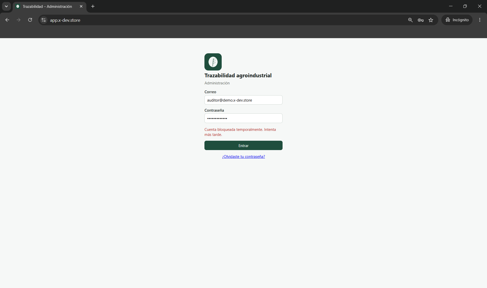

### 1.2 Recuperar la contraseña

Hay dos formas:

- **Autoservicio:** en el login, pulsar **¿Olvidaste tu contraseña?** e indicar el correo. Si el servidor tiene correo configurado se envía un enlace.
- **Por el administrador:** un administrador genera el enlace desde **Usuarios** y se lo entrega a la persona por otro medio.

El enlace sirve **una sola vez** y **vence a los 30 minutos**. Generar un enlace nuevo invalida el anterior. Al abrirlo se escribe la **Contraseña nueva** (mínimo 8 caracteres); al guardarla se cierran las sesiones abiertas de esa cuenta y se levanta cualquier bloqueo. Si el enlace ya se usó o venció, se muestra "El enlace no es válido o ya expiró" y se puede **Pedir un enlace nuevo**.

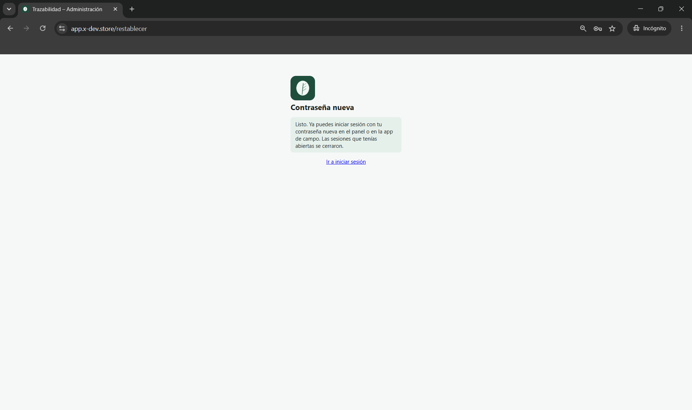
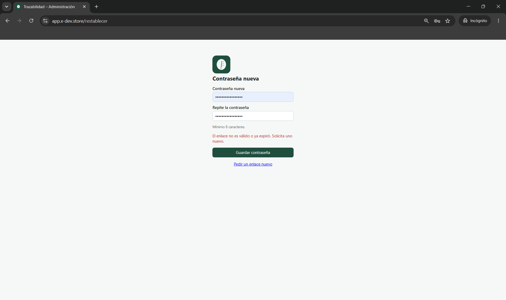

## 2. Módulos disponibles según el rol

| Módulo | Administrador | Supervisor | Calidad | Báscula/Bodega | Auditor |
|---|---|---|---|---|---|
| Auditoría | Consulta | — | — | — | Consulta |
| Calidad | Registra y consulta | Registra y consulta | Registra y consulta | Consulta | Consulta |
| Catálogos | Gestiona | Gestiona parcialmente | Gestiona grados de calidad | Consulta | Consulta |
| Lotes | Crea, anula, reimprime | Crea, anula, reimprime | Consulta | Crea y reimprime etiqueta | Consulta |
| Procesos | Registra y consulta | Registra y consulta | Consulta | Consulta | Consulta |
| Traslados | Despacha, recibe, cancela | Despacha, recibe, cancela | Consulta | Despacha y recibe | Consulta |
| Liquidaciones | Gestiona y paga | Crea, aprueba, anula | — | — | Consulta |
| Precios | Gestiona | Registra | — | — | Consulta |
| Recepciones | Consulta y registra pesajes | Consulta y registra pesajes | Consulta | Consulta y registra pesajes | Consulta |
| Usuarios | Gestiona | — | — | — | — |

Notas:

- El rol **Campo** no tiene módulos en la web: al entrar se muestra "Tu rol no tiene módulos en la web de administración. Usa la app de campo."
- La web oculta los botones que el rol no puede usar, pero el permiso real lo valida siempre el servidor: un intento no autorizado se rechaza aunque se haga por otra vía.
- En **Catálogos**, el Supervisor crea y edita productores, fincas, organizaciones y compradores; los centros de acopio solo los gestiona el Administrador; los grados de calidad los gestionan el Administrador y Calidad. Eliminar o desactivar registros de catálogo es exclusivo del Administrador.

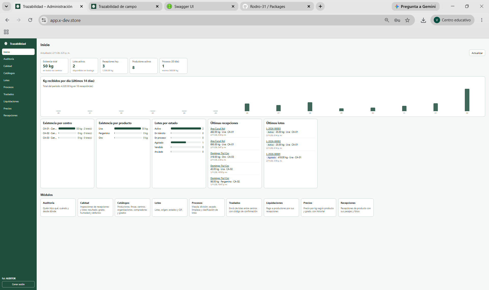

## 3. Funciones comunes

- **Listas con filtros y paginación:** los listados (recepciones, lotes, calidad, traslados, auditoría…) se filtran por centro, estado, producto, fechas u otros campos.
- **Exportar:** los listados que lo permiten tienen el botón **Exportar**, que descarga un archivo CSV que se abre en Excel. Los textos que empiezan con `=`, `+`, `-` o `@` se marcan como texto para evitar la inyección de fórmulas.
- **Volver:** cada pantalla de detalle tiene el enlace **← Volver a la lista**.

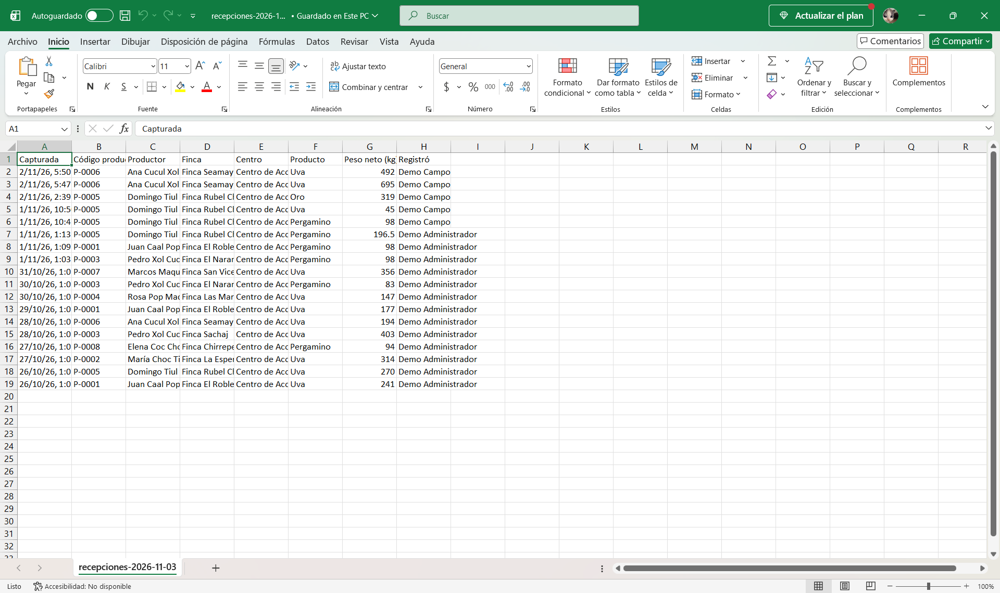

## 4. Inicio y dashboard

El **Dashboard** resume la operación con datos reales: existencia total, lotes activos, recepciones del día, procesos y merma, kg recibidos por día, **Existencia por centro**, **Existencia por producto**, **Lotes por estado**, **Últimas recepciones** y **Últimos lotes**. El botón **Actualizar** vuelve a consultar los datos.

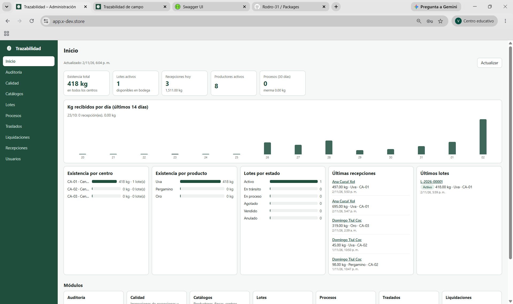

## 5. Recepciones

Las recepciones se capturan en el campo desde la PWA; aquí se consultan y se corrigen.

1. Abrir **Recepciones** y filtrar por centro, productor, producto o fechas.
2. Pulsar una fila para ver el detalle: peso bruto, tara, peso neto, humedad, observaciones y las **Fotos** subidas desde el teléfono.
3. **Historial de pesajes:** muestra todos los pesajes con fecha, motivo y quién los registró. Los pesajes anteriores nunca se borran.
4. **Registrar nuevo pesaje** (Administrador, Supervisor y Báscula): escribir **Peso bruto (kg)** y **Tara (kg)** y el **Motivo** (por ejemplo "corrección de báscula"). El peso vigente se actualiza y el anterior queda en el historial.
5. **Imprimir comprobante** o **Reimprimir comprobante (QR nuevo)**: el QR anterior queda revocado.
6. **Inspeccionar calidad** abre el formulario de calidad para esa recepción.

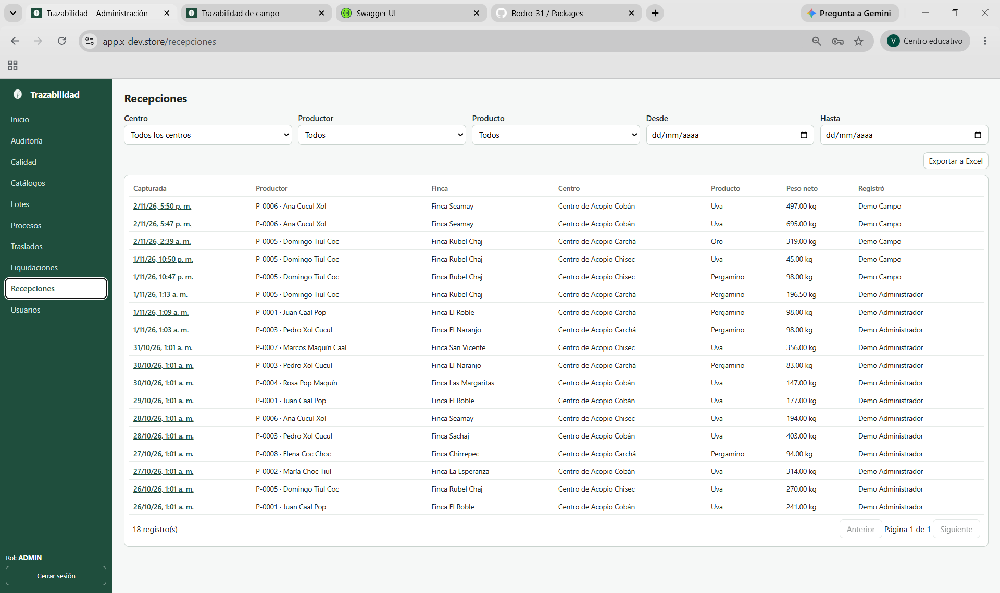
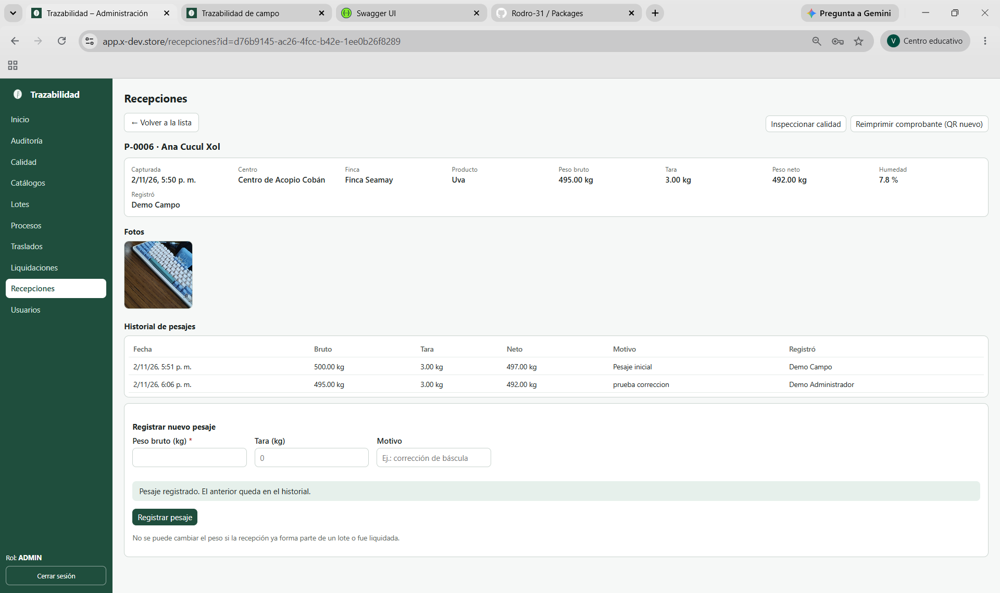

## 6. Calidad

Un usuario con rol Administrador, Supervisor o Calidad registra inspecciones; Báscula y Auditor solo consultan.

1. Abrir **Control de calidad** y pulsar **Registrar inspección**.
2. Elegir si se inspecciona **Una recepción** o **Un lote** y seleccionarlo.
3. Indicar el resultado (**Aprobada** o **Rechazada**), la **Humedad (%)**, las **Impurezas (%)**, los **Defectos (%)** y las **Observaciones**. Los porcentajes deben estar entre 0 y 100.
4. Opcionalmente elegir un grado: **si se elige un grado, pasa a ser el grado del lote.** "Sin asignar" lo deja pendiente.
5. Guardar. El historial de inspecciones nunca se sobrescribe: cada inspección es un registro nuevo.

La lista se filtra por resultado (Todos, Aprobadas, Rechazadas) y se puede exportar.

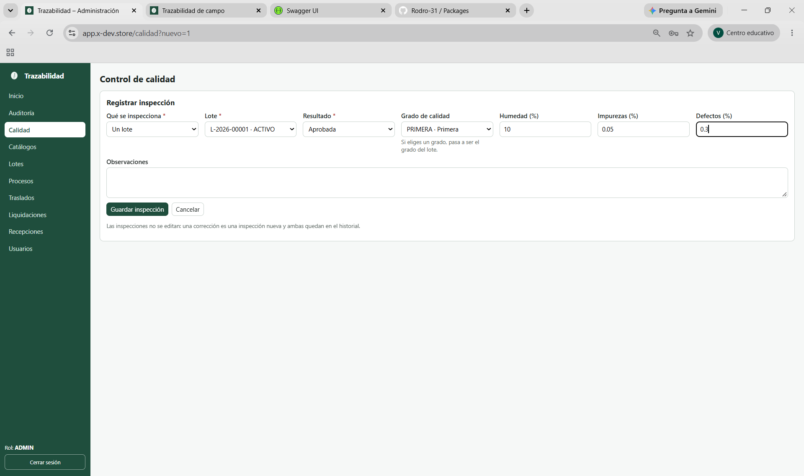
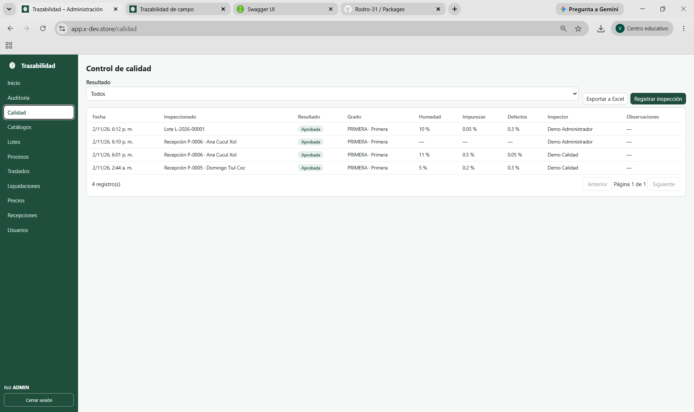

## 7. Lotes

Un lote **siempre nace de una o más recepciones**; no existen lotes sin origen.

### 7.1 Crear un lote

1. En **Lotes**, pulsar **Nuevo lote**.
2. Elegir el centro: se muestran sus recepciones con kg disponibles.
3. Marcar las **Recepciones de origen** y escribir los **Kg a tomar** de cada una. Todas deben ser del mismo producto (no se puede mezclar uva, pergamino y oro en un mismo lote) y no se puede tomar más de lo disponible.
4. Elegir el grado (o "Sin asignar (después de la inspección)") y guardar.
5. Se muestra el lote con su **etiqueta QR**; **Imprimir etiqueta** la envía a impresión.

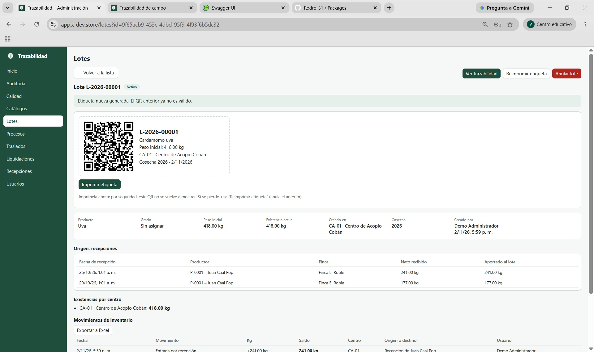

### 7.2 Detalle del lote

Muestra código, cosecha, producto, grado, peso inicial, **Existencia actual**, **Existencias por centro**, **Origen: recepciones** (productor, finca y kg aportados), **Movimientos de inventario**, **Historial de estados** y la **Relación con otros lotes** (de dónde viene o qué lotes derivó). Desde aquí también se puede **Reimprimir etiqueta** (revoca el QR anterior) y **Ver trazabilidad**.

### 7.3 Anular un lote

Solo Administrador y Supervisor, y solo si el lote está activo y no tiene procesos, traslados ni ventas. Pulsar **Anular lote**, escribir el motivo (entre 5 y 300 caracteres) y **Confirmar anulación**. El motivo queda en el historial.

### 7.4 Estados del lote

| Estado | Significado |
|---|---|
| Activo | Disponible en un centro |
| En tránsito | Despachado a otro centro, pendiente de confirmar |
| Agotado | Sin existencia (por ejemplo, tras una división) |
| Vendido | Vendido |
| Anulado | Anulado con motivo |

El estado "En proceso" existe en el modelo, pero no se utiliza: los procesos se registran ya terminados, en un solo paso. Agotado, Vendido y Anulado son estados finales: un lote no vuelve a activarse. Cada cambio de estado queda en el **Historial de estados**.

## 8. Trazabilidad

Desde el detalle de un lote, **Ver trazabilidad** responde de dónde viene y a dónde fue:

- **◀ Origen: productores y fincas:** productor, finca y kg aportados.
- **◀ Lotes de los que proviene:** lotes padre, si el lote nació de una mezcla, división o transformación.
- **Lotes que salieron de este ▶:** lotes derivados.
- **Ventas ▶:** compradores y destinos, cuando existen ventas registradas.

Con el botón **Certificado PDF** la trazabilidad se imprime o se guarda como PDF, en formato de certificado, sin menús ni botones.

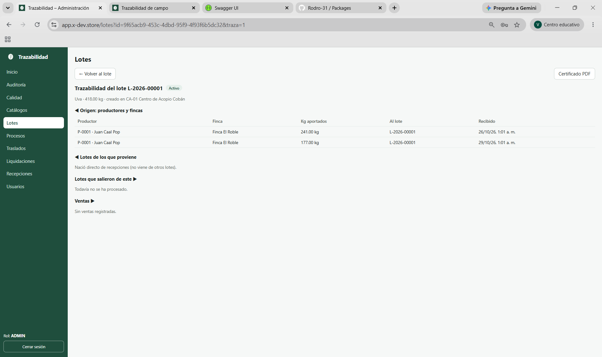
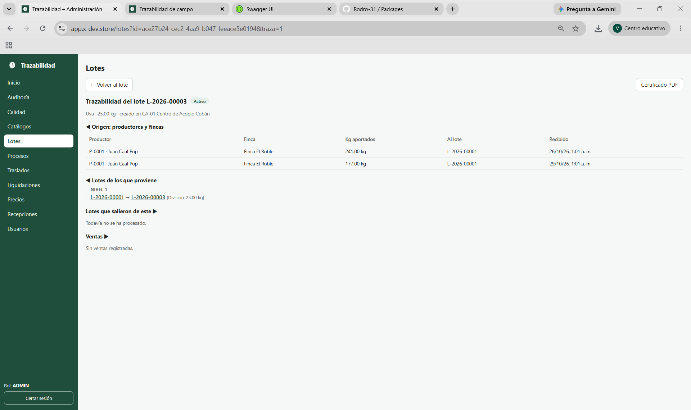

## 9. Procesos

Los procesos transforman lotes. Solo Administrador y Supervisor los registran.

| Tipo | Entradas | Salidas | Efecto |
|---|---|---|---|
| Mezcla | 2 o más lotes | 1 lote | Une varios lotes |
| División | 1 lote | 2 o más lotes | Reparte un lote |
| Secado | 1 lote | 1 lote | Uva → pergamino |
| Limpieza | 1 lote | 1 lote | Pergamino → oro |
| Clasificación | 1 lote | 1 o más lotes | Un lote por grado |

1. En **Procesos**, pulsar **Registrar proceso**.
2. Elegir el centro: se muestran sus lotes activos.
3. En el paso 1 elegir los lotes de entrada y los **Kg a tomar**.
4. En el paso 2, **Lotes que salen (kg pesados en báscula)**, indicar la salida. La diferencia se registra como merma.
5. **Registrar proceso**. Los lotes de entrada que se agotan pasan a "Agotado" y cada lote nuevo recibe su etiqueta QR.

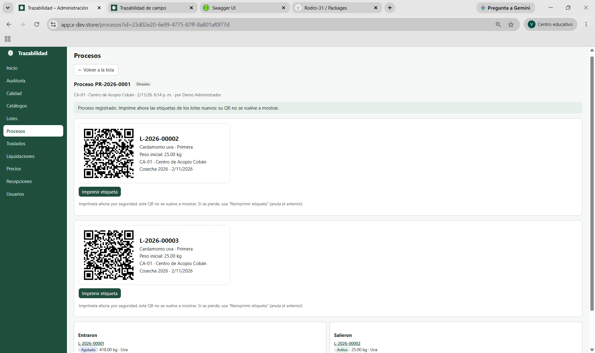

## 10. Traslados entre centros

Un traslado mueve un lote activo de un centro a otro y se confirma con un **código de confirmación**.

1. En **Traslados**, pulsar **Despachar lote**, elegir el lote y el centro de destino.
2. Se muestra el **código de confirmación para el centro de destino**. **Por seguridad no se vuelve a mostrar:** hay que entregarlo al transportista o **Imprimir comprobante**. El lote pasa a "En tránsito".
3. En el destino, una persona del centro destino abre el traslado, escribe el código y pulsa **Confirmar recepción**. El lote vuelve a "Activo" en el centro destino. Si llegan menos kg de los enviados se registra la merma en tránsito; no pueden llegar más.
4. Un traslado en tránsito puede **cancelarse** (Administrador y Supervisor) con un motivo; el código queda revocado.

El código vence a las **72 horas**, sirve una sola vez y solo funciona para su traslado.

## 11. Catálogos

Reúne los datos base: **productores, fincas, centros de acopio, organizaciones, compradores y grados de calidad**. Cada catálogo tiene su lista, búsqueda y formulario de alta o edición; los botones aparecen según el rol (ver sección 2). Los registros no se borran: al eliminarlos se **desactivan** y conservan su historial.

La creación de recepciones requiere que los centros, productores y fincas estén cargados previamente aquí.

**DPI del productor:** es un dato sensible. Solo el Administrador y el Supervisor lo ven, y únicamente en el detalle del productor; no aparece en las listas, en los QR ni en la auditoría (se muestra como `[OCULTO]`).

## 12. Precios y liquidaciones

**Precios** (Administrador y Supervisor; el Auditor consulta): precio por kg según producto y grado, con historial. Se puede filtrar por **Vigentes hoy** o ver el **Historial**. Sin precios vigentes las liquidaciones no pueden calcularse.

**Liquidaciones:** pago a productores por sus recepciones.

1. **Nueva liquidación:** elegir productor y período y pulsar **Calcular**. Se muestra una **Vista previa** con cada recepción, su precio por kg y su subtotal.
2. **Crear borrador** guarda la liquidación.
3. **Aprobar** (Administrador y Supervisor). **La aprobación debe hacerla una persona distinta de quien creó la liquidación** (segregación de funciones): si el mismo usuario intenta aprobarla, el sistema la rechaza con el mensaje "Quien creó la liquidación no puede aprobarla: debe hacerlo otra persona". Al crear una liquidación se genera además una tarea de aprobación.
4. **Registrar pago** (solo Administrador). La versión impresa de la liquidación incluye espacio para la **firma del productor**.
5. **Anular** (Administrador y Supervisor) mientras no esté pagada.

## 13. Usuarios (solo Administrador)

1. **Nuevo usuario:** nombre, correo, **Rol**, **Contraseña inicial** (mínimo 8 caracteres; entregarla por un canal privado) y los **Centros de acopio donde trabaja**.
2. **Editar:** cambiar nombre, rol, centros o estado. Al guardar cambios de seguridad se cierran las sesiones abiertas de esa persona.
3. **Desactivar** una cuenta impide el acceso; una cuenta **Bloqueada** por intentos fallidos se levanta con **Desbloquear**.
4. **Enlace de recuperación:** genera el enlace de un solo uso (30 minutos) para entregarlo a la persona.

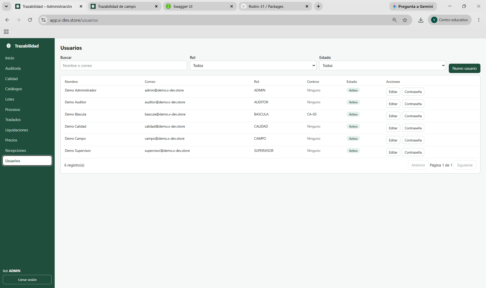
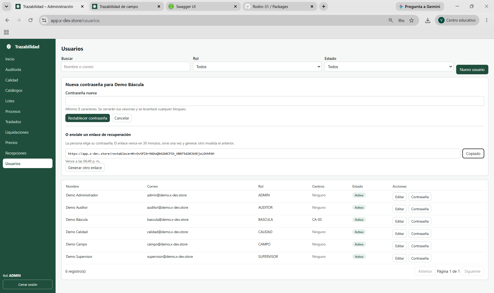
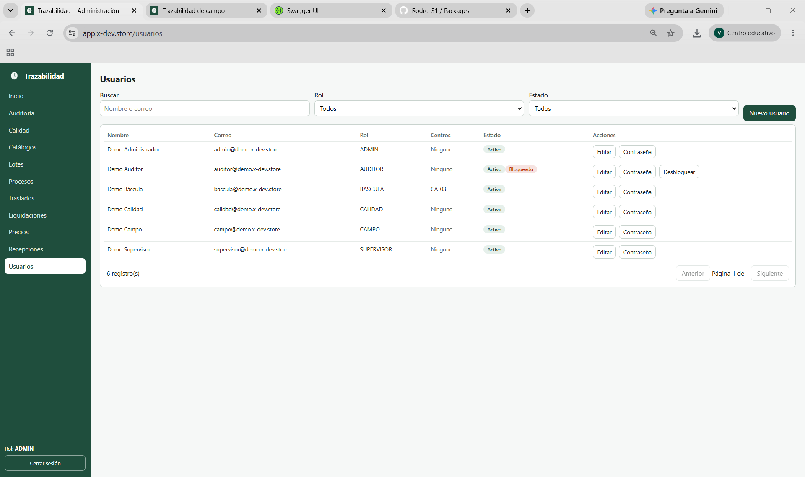

## 14. Auditoría (Administrador y Auditor)

Registra quién hizo qué, cuándo y desde qué IP: inicios de sesión exitosos y fallidos, bloqueos, recuperación de contraseña, inspecciones, procesos, pesajes y etiquetas QR.

1. Abrir **Auditoría** y filtrar por **Entidad**, **Acción** (por ejemplo `POST` o `LOGIN_FALLIDO`) y fechas (**Desde** / **Hasta**).
2. Pulsar **Ver** en un registro para consultar el estado **Antes** y **Después** de la operación.

Los campos sensibles (contraseñas, tokens, QR, DPI) aparecen como `[OCULTO]`.

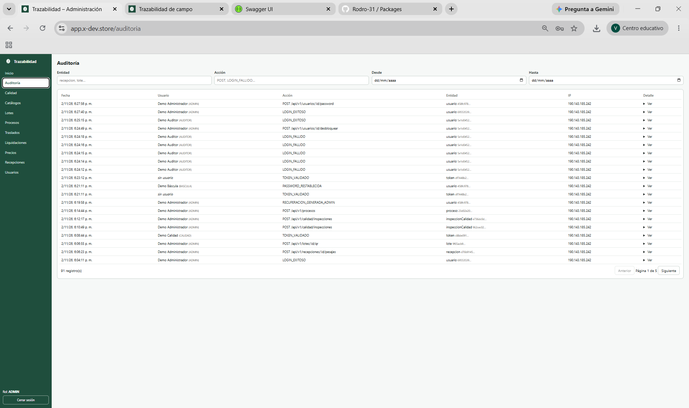
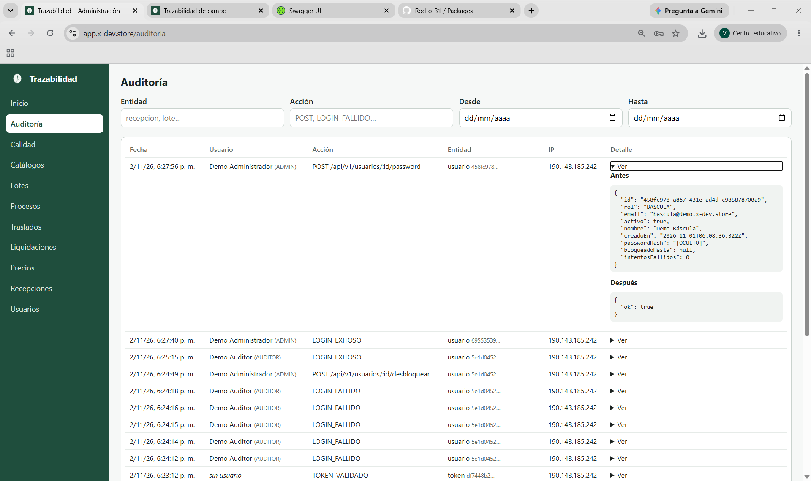

## 15. Preguntas frecuentes

| Situación | Qué hacer |
|---|---|
| No puedo entrar y dice "Credenciales inválidas" | Verificar correo y contraseña. Tras 5 errores la cuenta se bloquea 15 minutos; pedir al administrador que la desbloquee. |
| Mi enlace de recuperación "no es válido o ya expiró" | Ya se usó, venció (30 minutos) o se generó otro más reciente. Pedir uno nuevo. |
| No veo un módulo en el menú | Depende del rol (ver sección 2). Pedir al administrador que revise el rol asignado. |
| No encuentro un productor o finca al crear datos | Un administrador o supervisor debe cargarlo primero en **Catálogos**. |
| El código de confirmación de un traslado ya no se muestra | Es intencional. Si se perdió, cancelar el traslado (Administrador/Supervisor) y despacharlo de nuevo. |
