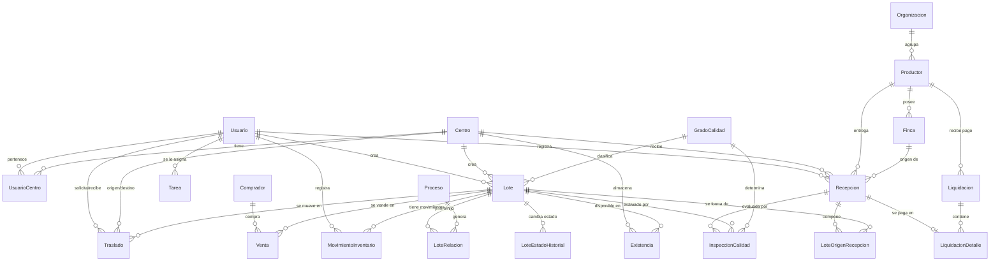

# Modelo de Datos y Entidad-Relación

El modelo de base de datos relacional (PostgreSQL) está diseñado para garantizar la integridad de la trazabilidad del cardamomo, el control estricto de inventarios y la auditoría de cada operación.

## Justificación de Relaciones Clave
* Trazabilidad Continua: La tabla Lote se relaciona de manera recursiva mediante LoteRelacion para formar el grafo de mezclas, divisiones y transformaciones (uva, pergamino, oro).  
* Origen Garantizado: Ningún lote existe en el vacío; obligatoriamente proviene de una Recepcion (vía LoteOrigenRecepcion) o de un lote previo.  
* Inventario Inmutable: MovimientoInventario actúa como un libro mayor donde solo se insertan registros, asegurando un rastro auditable, mientras que Existencia refleja el saldo actual.  
* Seguridad: Las tablas Token y Auditoria respaldan los flujos operativos, garantizando que confirmaciones como los traslados y el escaneo de QR dejen huella en el sistema. 
